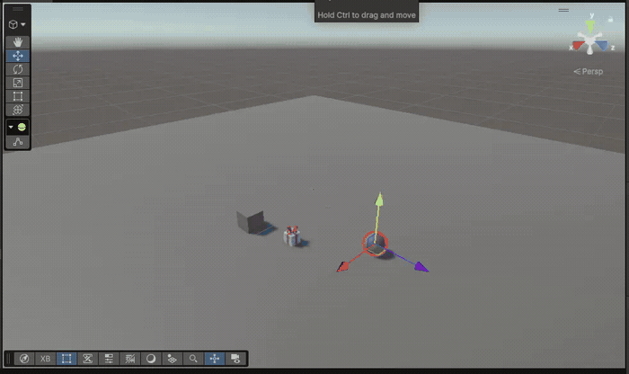

# Unity VR Interaction Exercise

## overview

I did the exercise on **Ubuntu Linux**.

The original exercise setup used the external Meta XR Simulator, which is made for a Windows environment. Because the original simulator setup could not be used in this Linux environment, I used **XR Device Simulator provided by the XR Interaction Toolkit**.

OpenXR is enabled for Android to allow a possible Meta Quest build. I disabled it for the Standalone computer platform to avoid the `DllNotFoundException` UnityOpenXR native-library error.

## packages and configuration

packages and samples:

- XR Plugin Management (XR Management)
- OpenXR Plugin
- XR Interaction Toolkit
- XR Interaction Toolkit Starter Assets
- XR Device Simulator sample
- TextMeshPro for the UI

### OpenXR interaction profiles

- Oculus Touch Controller Profile
- Meta Quest Touch Plus Controller Profile

## hierarchy

- **Directional Light:**
- **Floor:** - plane with a box collider to enable collision
- **XR Origin (XR Rig):** - imported from Starter Assets, it has the camera and controller setup
  - **Main Camera:** - player's viewpoint.
  - **Left Controller:** - additional child object Left Direct Interactor added
  - **Right Controller:** - has the controller and interaction components from Starter Assets
  - **Locomotion:** - the Locomotion Mediator and XR Body Transformer
- **XR Interaction Manager:** - for interactions between interactors and interactable objects
- **XR Device Simulator:** - simulates VR devices and controller input in Play Mode.
- **Interaction UI:** - contains a TextMeshPro text element

## objects

### cube

- Box Collider
- Rigidbody
- XR Simple Interactable
- colorChange script

The cube is selected using a Ray Interactor. It changes to purple when selected and back to its original color when deselected

### sphere

- Sphere Collider
- Rigidbody
- XR Simple Interactable
- colorChange script

The sphere is selected using a Ray Interactor. It changes to purple when selected and back to its original color when deselected

### present (Asset Store Object)

- Collider(s) covering the object
- Rigidbody
- XR Grab Interactable
- PresentUIFeedback script

The present is grabbed and released using the Direct Interactor.

Additional Left Direct Interactor created under the Left Controller that contains:
- XR Direct Interactor
- Sphere Collider configured as a trigger

When the present is grabbed or released, the UI message shows "Present grabbed" or "Present released".

## Scripts

### colorChange.cs

This script is attached to the cube and sphere.

1. renderer = GetComponent<Renderer>();
Gets the object's Renderer component.
2. interactable = GetComponent<XRBaseInteractable>(); 
Gets the interactible component
3. Saves the original material colour.
4. Changes the object's colour to purple when OnEnable() gets a message about interaction and calls private void OnSelected(SelectEnterEventArgs args).
5. Goes back to the original colour when the object is deselected - OnDisable()  gets a message about interaction and calls private void OnDeselected(SelectExitEventArgs args)

### presentPickUp.cs

This script is attached to the Christmas present.

It updates the UI when the present is grabbed or released.

The script listens for the selection and deselection events of XR Grab Interactable.

    private void OnEnable(){
    	interactable.selectEntered.AddListener(OnGrabbed);
    	interactable.selectExited.AddListener(OnReleased);
    }
    
    private void OnDisable(){
    	interactable.selectEntered.RemoveListener(OnGrabbed);
    	interactable.selectExited.RemoveListener(OnReleased);
    }
    
If either of them happens they call the correct method and the UI shows

- **"Present grabbed"** when the present is grabbed.
- **"Present released"** when the present is released.

# Ejercicio de interacción VR en Unity

## descripción general

Hice el ejercicio en **Ubuntu Linux**.

La configuración original del ejercicio utilizaba el simulador externo Meta XR Simulator, diseñado para un entorno Windows. Como no pude utilizar la configuración del simulador original en este entorno Linux, utilicé **XR Device Simulator, proporcionado por XR Interaction Toolkit**.

OpenXR está habilitado para Android para permitir una posible compilación para Meta Quest. Lo deshabilité para la plataforma Standalone del ordenador para evitar el error de biblioteca nativa `DllNotFoundException: UnityOpenXR`.

## paquetes y configuración

paquetes y muestras:

- XR Plugin Management (XR Management)
- OpenXR Plugin
- XR Interaction Toolkit
- XR Interaction Toolkit Starter Assets
- Muestra XR Device Simulator
- TextMeshPro para la interfaz de usuario

### Perfiles de interacción de OpenXR

- Oculus Touch Controller Profile
- Meta Quest Touch Plus Controller Profile

## jerarquía

- **Directional Light:** - luz direccional de la escena.
- **Floor:** - plano con un Box Collider para permitir las colisiones.
- **XR Origin (XR Rig):** - importado de Starter Assets; contiene la cámara y la configuración de los mandos.
  - **Main Camera:** - punto de vista del jugador.
  - **Left Controller:** - se añadió un objeto hijo adicional llamado Left Direct Interactor.
  - **Right Controller:** - contiene los componentes del mando y de interacción de Starter Assets.
  - **Locomotion:** - contiene Locomotion Mediator y XR Body Transformer.
- **XR Interaction Manager:** - gestiona las interacciones entre los interactores y los objetos interactuables.
- **XR Device Simulator:** - simula dispositivos VR y la entrada de los mandos durante Play Mode.
- **Interaction UI:** - contiene un elemento de texto TextMeshPro.

## objetos

### cubo

- Box Collider
- Rigidbody
- XR Simple Interactable
- Script colorChange

El cubo se selecciona mediante un Ray Interactor. Cambia a color morado cuando se selecciona y vuelve a su color original cuando se deselecciona.

### esfera

- Sphere Collider
- Rigidbody
- XR Simple Interactable
- Script colorChange

La esfera se selecciona mediante un Ray Interactor. Cambia a color morado cuando se selecciona y vuelve a su color original cuando se deselecciona.

### regalo (objeto de Asset Store)

- Collider(s) que cubren el objeto
- Rigidbody
- XR Grab Interactable
- Script PresentUIFeedback

El regalo se agarra y se suelta utilizando el Direct Interactor.

Se creó un Left Direct Interactor adicional debajo de Left Controller que contiene:
- XR Direct Interactor
- Sphere Collider configurado como trigger

Cuando se agarra o se suelta el regalo, el mensaje de la interfaz muestra "Present grabbed" o "Present released".

## Scripts

### colorChange.cs

Este script está asociado al cubo y a la esfera.

1. renderer = GetComponent<Renderer>();
Obtiene el componente Renderer del objeto.
2. interactable = GetComponent<XRBaseInteractable>(); 
Obtiene el componente de interacción.
3. Guarda el color original del material.
4. Cambia el color del objeto a morado cuando OnEnable() recibe un mensaje de interacción y llama a private void OnSelected(SelectEnterEventArgs args).
5. Vuelve al color original cuando el objeto se deselecciona - OnDisable() recibe un mensaje de interacción y llama a private void OnDeselected(SelectExitEventArgs args).

### presentPickUp.cs

Este script está asociado al regalo de Navidad.

Actualiza la interfaz cuando se agarra o se suelta el regalo.

El script escucha los eventos de selección y deselección de XR Grab Interactable.

    private void OnEnable(){
    	interactable.selectEntered.AddListener(OnGrabbed);
    	interactable.selectExited.AddListener(OnReleased);
    }
    
    private void OnDisable(){
    	interactable.selectEntered.RemoveListener(OnGrabbed);
    	interactable.selectExited.RemoveListener(OnReleased);
    }
    
Si ocurre cualquiera de estos eventos, se llama al método correspondiente y la interfaz muestra:

- **"Present grabbed"** cuando se agarra el regalo.
- **"Present released"** cuando se suelta el regalo.
